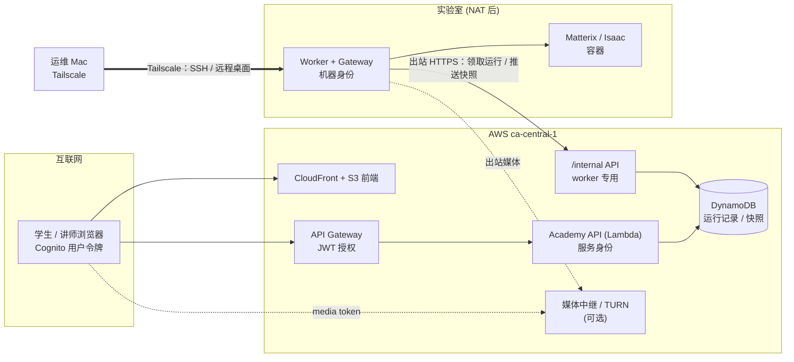
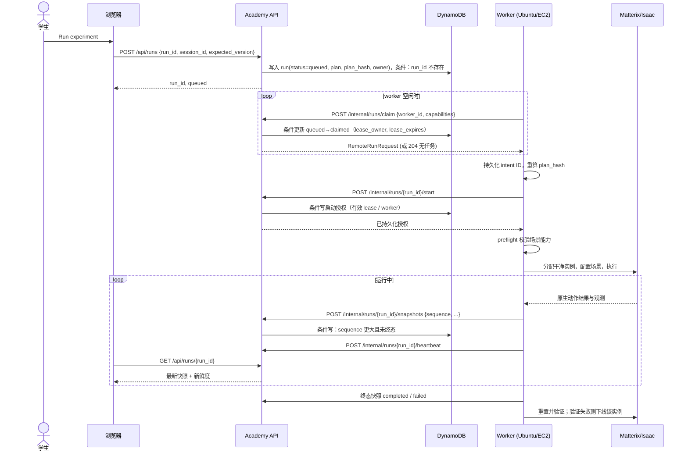
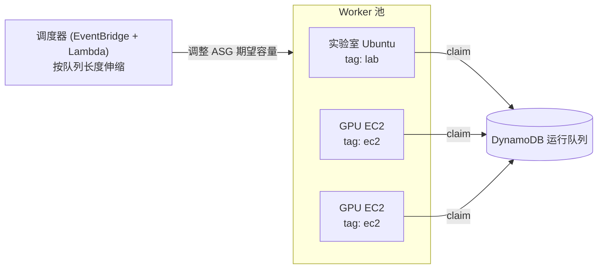

# 访问与权限模型：网页用户、AWS 与 Matterix 仿真主机

状态：分阶段实施（2026-10-01）。第一阶段的持久化调度、独立机器 API、worker 日志与状态界面已实现；原生 Ubuntu、媒体、多租户和 EC2 池仍待实施/验收。实际交付范围及接口以 [Worker 控制平面](WORKER-CONTROL.md) 为准；云端部署证据另见 AWS 文档。本文补充 [同步执行设计](SYNCHRONIZED-RUNS.md)、[Ubuntu 主机接入](REMOTE-UBUNTU.md) 和 [AWS 部署](AWS.md)，回答一个问题：**学生只用浏览器，Academy 部署在 AWS，仿真主机在实验室（经 Tailscale 由运维访问），将来可能动态使用 EC2——权限和连接该怎么设计？**

## 1. 结论

1. **学生永远不接触 Tailscale、Ubuntu、远程桌面或 Isaac 编辑器。** 浏览器只与 AWS 上的 Academy 通信，只持有 Cognito 用户令牌。
2. **控制平面采用“worker 出站拉取”。** Ubuntu（以及将来的 EC2）上的 worker 主动连接 AWS 领取运行、回传累积快照。实验室不开放任何入站端口。
3. **媒体平面独立鉴权。** 3D 画面通过按运行签发、短时效、只读的 media token 访问。远程桌面只用于运维。
4. **学生输入只是数据，不是代码。** 只接受受限的动作描述（动作、体积、孔位、耗材布局），由仿真主机侧 adapter 预检。不接受上传脚本。
5. **四类身份严格分离**：用户（学生/讲师/管理员）、服务（Academy API）、机器（worker）、运维（你）。任何一类凭据都不能代替另一类使用。

## 2. 需求与威胁模型

### 2.1 需要保证的

| 需求 | 来源 |
|---|---|
| 同一份流程、同一次运行，Sim 实际状态驱动界面 | SYNCHRONIZED-RUNS.md |
| “收到指令”不算完成；断线恢复原运行，不重新执行 | SYNCHRONIZED-RUNS.md |
| 画面或状态延迟时界面明确显示 | SYNCHRONIZED-RUNS.md |
| 学生、企业员工只用网页 | 产品要求 |
| 网页在 AWS，仿真主机暂用实验室 Ubuntu，将来可用 EC2 | 部署计划 |
| 避免真机损坏：本系统只连仿真，不连真实设备 | 培训目的 |

### 2.2 要防的

| 威胁 | 例子 | 对策（章节） |
|---|---|---|
| 学生获得主机控制权 | 通过远程桌面、Isaac 编辑器、Python 控制台执行任意代码 | §6、§9 |
| 学生互相干扰 | 看到或控制别人的运行、抢占正在运行的实例 | §5、§7、§9 |
| 实验室网络被暴露 | 为了让 AWS 访问而在公网开端口 | §4 |
| 凭据泄露扩散 | 前端里出现 gateway token；worker token 能读学生数据 | §3、§8 |
| 重复执行 | 超时后自动重试导致移液执行两次 | §4.4 |
| 伪造或过期状态 | 旧快照、其他会话的快照覆盖当前进度 | §4.5 |
| 媒体链接被转发 | 视频 URL 被分享给未授权的人 | §6.3 |
| 企业租户之间的数据泄露 | 讲师看到其他公司的学员记录 | §7.2 |

不在本文范围内：真实机器人控制、对抗 GPU 驱动级漏洞、实验室物理安全。

## 3. 身份与信任区



| 身份 | 凭据 | 存放 | 可以做 | 不可以做 |
|---|---|---|---|---|
| 学生 | Cognito access token（短时效，PKCE） | 浏览器 session storage | 自己的实验与运行 | 任何 `/internal`、他人数据、主机 |
| 讲师（规划中） | 同上 + `instructors` group | 同上 | v1 不支持跨用户读取；班级/租户成员关系与只读视图待实施 | 改学员数据、控制运行 |
| 网页管理员（规划中） | 同上 + `admins` group | 同上 | 管理页面待实施；当前使用 IAM 运维 CLI | 登录主机 |
| Academy API | Lambda 执行角色（IAM） | AWS | 读写 DynamoDB；media token 签发待实施 | 直接访问实验室网络 |
| Worker | 机器凭据（§8） | 主机上的 root-only 文件 / systemd credential | 领取运行、推送本运行的快照与心跳 | 读学生资料、列出其他运行、签发用户令牌 |
| 运维 | Tailscale 身份 + SSH key | 运维个人设备 | SSH、远程桌面、部署 | 以学生身份操作（应使用测试账号） |

原则：

- 用户令牌永远不发往 worker；worker 只看到 `run_id`、`session_id`、不可变的计划和 plan_hash，不需要学生姓名或邮箱。
- `ACADEMY_GATEWAY_TOKEN` 一类的服务凭据不进前端环境变量、URL、表单或日志（REMOTE-UBUNTU.md 已有此要求）。

## 4. 控制平面

### 4.1 方案比较

| 方案 | 描述 | 实验室入站端口 | 复杂度 | 扩展到 EC2 | 结论 |
|---|---|---|---|---|---|
| A. Worker 出站拉取 | worker 轮询或长连接 AWS，领取运行、推送快照 | 无 | 低 | 同一镜像直接复用 | **推荐** |
| B. Lambda 入 VPC + Tailscale 子网路由 | Lambda 经 VPC 内一台 Tailscale 节点访问 Ubuntu | 无（走 tailnet） | 中：NAT 网关、路由节点、Lambda 冷启动变慢 | 每台新机器都要入网、加路由 | 备选 |
| C. Ubuntu 公网 HTTPS | 实验室开放端口 | 有 | 低 | — | **不采用** |
| D. Tailscale Funnel | 把 Ubuntu 服务经 Tailscale 发布到公网 | 无，但服务等同公开 | 低 | — | 不采用 |

选 A 的理由：

1. 实验室在 NAT 和学校防火墙后面，出站 HTTPS 一般可用，入站通常不被允许。
2. 条件写负责唯一领取；执行前还必须持久化启动授权，本地 intent 日志与原生 gateway 持久化去重共同防止重放。条件写本身不等于原生只执行一次。
3. 断线恢复读的是 AWS 中已持久化的快照，不需要实时到达 Ubuntu。
4. 实验室主机和将来的 EC2 都只是“worker”，调度逻辑只写一次。

### 4.2 拉取模式下的端到端流程



与 SYNCHRONIZED-RUNS.md 的关系：原文提出 Academy API 调用 gateway 的 `POST/GET /v1/sessions/{session_id}/runs`。拉取模式**反转调用方向，语义不变**：run_id 幂等、plan_hash 规范化、累积快照、单调 sequence、终态规则、确认时间与观测修订号规则都照搬。若暂时保留 gateway 端点，也可以只在 worker 内部使用，由 worker 自己把结果转成 `/internal` 推送。

### 4.3 运行状态机（服务器侧）

```
queued ──claim──▶ claimed ──worker 报告启动──▶ starting ──▶ running ──▶ completed
   │                 │                                      │   ▲
   │                 └──lease 过期──▶ outcome_unknown    │   │pause/resume
   │                                                         ▼   │
   └──用户取消──▶ cancelled                    pause_requested ─▶ paused
                                                             │
                     lease 过期且已有执行快照 / worker 报告无法恢复
                                                             ▼
                                                     outcome_unknown
running ──原生失败──▶ failed
```

规则：

- v1 的 claimed 任务一律不自动回队。没有快照不能证明没有原生执行；过期后进入 outcome_unknown，等待运维对账与清理。
- 已经开始执行而 worker 失联：进入 `outcome_unknown`，界面显示“结果未知”，**不自动重跑**。运维完成原生对账与重置验证后，以**新的 run_id** 重新提交。
- `completed` / `failed` / `cancelled` / `outcome_unknown` 为终态，之后改变状态的快照拒绝；相同终态快照重传仍返回成功确认。

### 4.4 抢占（lease）、启动授权与禁止不确定重放

DynamoDB 条件更新示意：

```text
UpdateItem run#<run_id>
  SET status = :claimed, lease_owner = :worker_id,
      lease_expires = :now_plus_60s, claim_token = :uuid
  CONDITION status = :queued
            AND required_scene IN worker.capabilities
```

- 只有一个 worker 能成功；其余收到条件失败，继续等待下一个任务。
- 返回的 `claim_token` 之后每次推送都必须携带。lease 被回收后，旧 worker 的推送会因 token 不匹配而被拒绝（防止“僵尸 worker”写入；这本身不能阻止旧模拟器动作，因此不可重新派发其资源）。
- worker 每 15–20 秒发一次心跳续租；lease 时长约为心跳间隔的 3 倍。
- **不存在自动重试 POST 执行的路径。** worker 自己若在执行中崩溃重启：用本地持久化的 `run_id + claim_token` 调用 `GET /internal/runs/{run_id}` 读回服务器记录；能从 Sim 恢复原运行就继续推送（sequence 接续），不能就报告 `outcome_unknown`。

### 4.5 快照写入校验（服务器侧）

`POST /internal/runs/{run_id}/snapshots` 在写入前检查：

| 检查 | 失败时 |
|---|---|
| 机器凭据有效，且 `lease_owner == worker_id`、`claim_token` 匹配 | 403 |
| `run_id`、`session_id`、`plan_hash` 与记录一致 | 409，告警 |
| `sequence` 大于已存值；同一 sequence 内容必须逐字节相同（幂等重放） | 同 sequence 不同内容或更小 → 409 |
| 终态不改变；相同已保存报告重传可确认 | 改变终态 → 409 |
| 步骤顺序不变；已确认的步骤不被撤回 | 409 |
| 完成步骤有确认时间与观测修订号，且时间与修订号非递减 | 422 |
| 同一原生观测修订号的内容不变 | 409 |

浏览器端保留现有客户端校验（双重检查）。API 只把**已通过校验并持久化**的快照返回给浏览器。

### 4.6 内部 API 一览

| 端点 | 调用方 | 作用 |
|---|---|---|
| `GET /internal/workers/me` | worker 启动时 | 读取运维登记的身份、版本、资格与活动运行；登记由 operator CLI 完成 |
| `POST /internal/runs/claim` | worker | 领取一个匹配能力的运行；无任务返回 204（v1 短轮询并退避，不占用 Lambda 等待 20 s） |
| `GET /internal/runs/{run_id}` | worker | 崩溃恢复时读回服务器记录 |
| `POST /internal/runs/{run_id}/snapshots` | worker | 推送累积快照 |
| `POST /internal/runs/{run_id}/heartbeat` | worker | 续租 |
| `POST /internal/runs/{run_id}/start` / `binding` | worker | 获取一次性启动授权，绑定原生 session/revision；心跳响应携带 control |
| `POST /internal/runs/{run_id}/cleanup` | worker | 报告原生重置与释放后的验证收据；失败保留隔离与会话锁 |

路由层面：`/internal/*` 使用**单独的 authorizer**，不接受 Cognito 令牌；`/api/*` 不接受机器凭据。第一阶段采用单独 HTTP API、authorizer 与 Lambda 并发配额，避免串用和相互占满容量。

### 4.7 实时性

先用轮询：worker 推送节奏按事件（每个动作完成）+ 每 1–2 s 的心跳快照；浏览器每 1–2 s 读一次。之后需要更低延迟时，可加 API Gateway WebSocket 或 AppSync 订阅，**只改传输方式，不改状态所有权和完成规则**。

## 5. 暂停、取消与浏览器断线

- 暂停、取消是**请求**：浏览器提交带 command_id 和 expected_version 的控制请求，服务器原子写入 `control` 字段，worker 在下一个可支持的边界执行，并以快照确认。界面在确认前显示 “Pause requested”。
- 关闭或刷新浏览器不影响运行。重新打开时按 run_id 读取。
- 浏览器轮询失败：保留最后确认的状态和时间戳，显示 “Reconnecting / 状态已过期 N 秒”，绝不推进时间线。
- 讲师旁观为只读，v1 不提供讲师控制学员运行。

## 6. 媒体平面（3D 画面）

> **实施说明（2026-10-16）**：已实现的是方案 A 的一个变体，而不是下面推荐的“B 为主”。主机侧 `native_media.py` 从共享内存读取 Isaac RGB 帧，经 Amazon Kinesis Video Streams（KVS）WebRTC 信令发布；浏览器用 VIEWER 身份连接，ICE 只走 KVS TURN 中继，主机无需入站端口。Academy API 按运行签发 MASTER / VIEWER 授权（`media.py`），viewer 租约 35 秒，发布端在已建立的连接上也持续核对 allowlist。§6.3 的自签 media token 由这套 KVS 授权取代。方案 B（浏览器端渲染）仍是可选的后续工作。以上仍未经真实 GPU 画面验收，见 [ISAAC-WEB-TOPOLOGY.md](ISAAC-WEB-TOPOLOGY.md) 与 [STATUS.md](STATUS.md)。

### 6.1 不能给学生远程桌面的原因

远程桌面（VNC/RDP/NoMachine 等）给出的是整台主机的桌面：文件系统、终端、Isaac 编辑器里的 Python 脚本编辑器、其他学员的会话。这等同把主机交给学生，只能留给运维。

### 6.2 两种方案

| | A. Isaac WebRTC 视频流 | B. 浏览器端渲染孪生体 |
|---|---|---|
| 原理 | 仿真主机 GPU 编码视口画面，WebRTC 推给浏览器 | Sim 回传物体位姿、关节角、液量、吸头状态和 tick；浏览器用 three.js 渲染预先导出的 glTF 场景 |
| 画面真实度 | 与 Isaac 渲染一致 | 取决于导出资产与渲染质量 |
| 与状态同步 | 两条通道，需按 tick 对齐 | 与结构化状态来自同一快照，天然一致 |
| 网络 | 实验室在 NAT 后，通常需要 TURN 中继（UDP，或 TCP/TLS 443 回退） | 普通 HTTPS，带宽小 |
| 服务器成本 | 每路流占 GPU 编码，并发有限 | 不占服务器 GPU，可多人旁观 |
| 安全面 | 必须过滤输入事件，只放行相机操作 | 浏览器不向 Sim 发送任何输入 |
| 适用 | “真实渲染”视图、演示 | 主培训视图 |

长期建议：**B 做主视图，A 做可选视图**。第一阶段先交付结构化原生状态，不新增 Three.js；浏览器渲染只减少服务端视口编码开销，不免除原生仿真 GPU。B 还让“画面对应这次运行”可以被检验：每帧都来自带 run_id 和 tick 的快照。

实施 B 需要：从 USD 场景导出 glTF（或等价格式）并版本化，与 `asset_version` 绑定；snapshot 增加 `poses`（对象 ID → 位姿）和 `joints` 字段；浏览器拒绝资产版本不匹配的快照。

实施 A 需要：确认所用 Isaac 版本的 livestream 组件和客户端方式（参见 [Isaac Sim streaming](https://docs.isaacsim.omniverse.nvidia.com/latest/installation/manual_livestream_clients.html)）；在 AWS 上部署 TURN（如 coturn on EC2）或使用托管 WebRTC 服务；做输入白名单（见 §6.4）。

TURN 只提供传输中继，不直接验证 Academy 的运行权限。实施 A 必须另有鉴权的信令/媒体服务，验证该 Isaac 版本的出站连接、单客户端限制、多人分发和服务器侧输入控制；不能假设部署 coturn 即可接通。

### 6.3 Media token

由 Academy API 在用户有权查看该运行时签发：

```json
{
  "iss": "academy-api",
  "aud": "academy-media",
  "sub": "<cognito sub>",
  "tenant": "<org id>",
  "session_id": "...",
  "run_id": "...",
  "scope": "media:view",
  "camera_control": true,
  "exp": 1790000000,
  "jti": "<uuid>"
}
```

- bearer token 在有效期内仍可能被转发；必须绑定播放会话，并由媒体服务处理到期断流/撤销。有效期短（建议 2–5 分钟），播放中由浏览器向 Academy API 续签；运行终态后不再续签。
- 用 KMS 非对称密钥签名；中继 / worker 只持有公钥，可离线验证。
- 中继或 worker 校验 `aud`、`exp`、`run_id` 与当前正在推流的运行一致。
- 旁观者（讲师）签发 `camera_control: false`。
- TURN 凭据同样按会话临时生成（TURN REST API 风格的时效用户名/密码），不使用长期固定密码。

### 6.4 输入白名单（方案 A）

只转发：相机环绕、平移、缩放、重置视角。丢弃：键盘事件、视口内点选/拖拽物体、菜单、任何会触达 Isaac UI 或脚本编辑器的输入。若该版本的流组件无法在服务器侧过滤输入，则方案 A 只能以“纯观看”方式提供。

## 7. 角色与多租户

### 7.1 权限矩阵

| 能力 | 学生 | 讲师 | 管理员 | Worker | 运维 |
|---|---|---|---|---|---|
| 创建、编辑自己的实验 | ✓ | — | — | — | — |
| 提交运行、暂停/取消自己的运行 | ✓ | — | — | — | — |
| 查看自己的运行与媒体 | ✓ | — | — | — | — |
| 只读查看本班学员运行与媒体 | — | ✓（本租户） | ✓ | — | — |
| 管理课程、场景能力开关 | — | — | ✓ | — | — |
| 查看 worker 池与隔离状态 | — | — | ✓ | — | ✓ |
| 领取运行、推送快照 | — | — | — | ✓（仅已领取的运行） | — |
| SSH、远程桌面、Isaac 编辑器 | ✗ | ✗ | ✗ | ✗ | ✓ |
| 部署、轮换凭据 | ✗ | ✗ | ✗ | ✗ | ✓ |

### 7.2 企业租户

当前 AC dev 的普通学习入口允许完整域名为 `utoronto.ca` 的邮箱自行注册，完成 Cognito 邮件验证码验证后无需人工审批。此规则只决定注册准入，不授予讲师、管理员或真实设备权限，也不代表大学 SSO 或持续在校身份认证；其他邮箱仍可由管理员邀请。配置与撤回方式见 [AWS.md](AWS.md#learner-registration)。

- 后续多租户：推荐后端按 authorizer 中的 sub 查询运维维护的租户/班级成员关系；若改用 Cognito custom 属性，必须禁用客户端写权限，并配置 V2_0 pre-token trigger 将授权声明加入 access token。custom 属性默认只进入 ID token。第一阶段仍按 sub 隔离，不开放讲师跨用户读取。
- DynamoDB 主键以 tenant 为前缀，例如 `PK = TENANT#<id>#USER#<sub>`；API 层从令牌取 tenant，不接受请求体里传入的 tenant。
- 讲师权限 = 角色 group ∧ 相同 tenant ∧ cohort 在其负责列表中。
- 可选：企业客户需要专属算力时，给 worker 加 `tenant` 标签，claim 时按标签匹配。

## 8. Worker 机器凭据与密钥管理

| 阶段 | 方式 | 说明 |
|---|---|---|
| v1（实验室） | 每台 worker 一个 scoped 机器 token | 只授权 `/internal/*`；服务器端只存哈希；放 systemd `LoadCredential` 或 root-only 文件；90 天轮换；可单独吊销 |
| v2（实验室） | IAM Roles Anywhere + 主机证书 | 无长期密钥；`/internal` 改用 IAM 授权 |
| EC2 | IAM instance role | 无需分发任何密钥 |

- Academy 侧的签名密钥、TURN 共享密钥放 AWS Secrets Manager / KMS。
- worker 日志不记录 token、media token 或完整请求头。
- worker 凭据被吊销后，其持有的 lease 立即失效（claim_token 作废），正在执行的运行进入 `outcome_unknown`。

## 9. 仿真主机加固

### 9.1 进程与文件

- worker / gateway 以专用非登录用户（如 `matterix-worker`）运行，systemd 管理。
- Isaac / Matterix 运行在容器中（NVIDIA Container Toolkit），只挂载场景资产（只读）和一个按运行划分的临时目录；不挂载运维的 home、SSH key、Tailscale 状态。
- 关闭或不发布 Isaac 中可执行任意代码的扩展端点（脚本编辑器、远程 Python/Kit 命令端口等）给容器外部。
- 容器出站网络只允许访问 Academy `/internal` 和媒体中继。

### 9.2 学生输入

- 只接受 `Experiment` 模型定义的字段；worker 侧重新验证并重算 plan_hash。
- adapter 把逻辑对象（tips、stock、plate、waste）和孔位映射到当前场景版本的标签与变换；不支持的布局、体积、动作直接 preflight 失败，不替换成预设流程（SYNCHRONIZED-RUNS.md 已有此规则）。
- “Sandbox 工作流设计”也走同一个受限 DSL，通过管理员开启更多动作类型来扩展，而不是开放脚本。
- 体积、步骤数、运行时长设上限，防止占满 GPU。

### 9.3 隔离与重置

- 每个实例同一时间只服务一个 lease。
- 运行结束后重置并**验证**（对象 ID、液量、吸头状态回到初始值）。验证失败 → 实例隔离，不再领取任务，通知运维。
- 将来资源允许时，优先“每次运行一个全新容器”，用镜像启动时间换取更强的隔离。

### 9.4 Tailscale ACL 示例

worker 本身不依赖 tailnet。tailnet 只用于运维：

```json
{
  "groups": {"group:operators": ["<operator-email>"]},
  "tagOwners": {
    "tag:sim-host": ["autogroup:admin"],
    "tag:sim-service": ["autogroup:admin"]
  },
  "acls": [
    { "action": "accept", "src": ["group:operators"], "dst": ["tag:sim-host:22", "tag:sim-host:<remote-desktop-port>"] }
  ],
  "ssh": [
    { "action": "check", "src": ["group:operators"], "dst": ["tag:sim-host"], "users": ["<operator-user>"] }
  ]
}
```

（端口和用户名按实验室实际配置填写。部署前在 Tailscale 管理后台预览 ACL 效果。）

## 10. 扩展到 EC2



- 同一个 worker 容器镜像；EC2 放私有子网，经 NAT 访问当前公开但鉴权的 HTTP API。API Gateway 的 interface VPC endpoint 仅适用于私有 REST API；若要该路径，需另行设计 REST API，不能直接替换 NAT。
- 用 Auto Scaling Group，按“排队中的运行数”调整期望容量；空闲 N 分钟缩到 0。
- Isaac 启动慢：可保留 1 台预热实例，或使用 warm pool / 预烘焙 AMI。
- 实例类型、区域 GPU 配额和价格需按课堂规模另行评估。
- 调度策略：优先实验室主机（已付费），排队超过阈值再起 EC2。

## 11. 对现有仓库的影响

| 文件 | 已实现与剩余工作 |
|---|---|
| `SYNCHRONIZED-RUNS.md` | 已定义 worker 拉取与 claim/lease/claim_token、`outcome_unknown` 的触发规则 |
| `REMOTE-UBUNTU.md` | 已定义 worker 注册与机器凭据配置；worker 仍需私有 gateway URL，Ubuntu 部署待验收 |
| `MATTERIX-CONTRACT.md` | engine/asset 版本绑定已实现；`poses`、`joints` 与媒体方案仍待实施 |
| `infra/` | 已实现 `/internal` 独立 API、authorizer 与 worker 注册；KMS 媒体签名和 TURN 待实施 |
| `app/` | 已实现 `/api/runs`、`/internal/*` 与快照校验；media token 签发待实施 |
| 新组件 | Python worker 与 systemd 模板已实现；Ubuntu 原生安装与验收待完成 |

## 12. 建议实施顺序

1. AWS 侧：运行记录表、`POST /api/runs`、`GET /api/runs/{id}`、`/internal` 独立授权与 claim/snapshot/heartbeat 端点，用模拟 worker 测试条件写和校验。
2. Ubuntu 侧：worker 骨架（注册、claim、心跳），先回放固定快照，打通网络与凭据（不碰 Isaac）。
3. 接入 Matterix adapter：100 µL 单次转移，原生观测回传；对丢失启动/终态/重置/释放响应、worker 重启和日志丢失逐一验收，确认至多执行一次且未知结果不重跑。
4. 浏览器：渲染远程快照、新鲜度与 “Reconnecting / Outcome unknown” 状态。
5. 媒体方案 B：导出场景资产、位姿流、浏览器渲染。
6. 媒体方案 A（可选）：TURN、media token、输入白名单。
7. 多租户与讲师只读视图。
8. EC2 worker 池。

每一步的验收沿用 SYNCHRONIZED-RUNS.md 的验收场景，契约测试通过不等于原生验收通过。

## 13. 待决问题

- 实验室防火墙是否允许出站 HTTPS 长连接 / 长轮询？是否允许出站 UDP（影响方案 A 是否需要 TCP 443 回退）？
- 当前 Isaac 版本的 livestream 组件能否在服务器侧过滤输入？
- 一台实验室 GPU 能同时跑几个隔离实例？重置验证需要多长时间？
- 运行时长上限、每人每日运行配额？
- 企业客户是否要求数据驻留在特定区域、是否需要专属 worker？
- 学习记录保留多久，谁可以导出？
