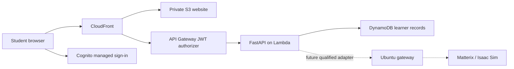

# Architecture and boundaries

## Runtime

Academy owns identity, curriculum, learner work, teaching attempts and session allocation. Matterix will own the physical simulation state, device actions and scene changes. A thin adapter maps the versioned contract; it must not introduce a second physics state or independently choose retries and recovery for uncertain remote execution.

The teaching runner is an isolated educational model, not a compatibility implementation of Matterix. Its evidence source is always `synthetic`. The UI never converts a gateway error into a teaching result or a synthetic result into a GPU claim.

## Teaching semantics

The available experiment begins with stock at 100% and three wells containing diluent. Each dispense uses ideal instantaneous mixing. The pipette holds at most 300 µL; modeled containers hold at most 1,500 µL. A new tip is required after dispensing before the next aspiration. This is a lesson policy, not a quantitative contamination or vendor sensor model. Discarded liquid and solute are accounted for in waste. Rejecting an invalid operation leaves the liquid state unchanged and records the failed step.

An action sequence completes independently of course success. The assessment checks the three target concentrations and that the tip is discarded with no remaining pipette liquid. The visual deck is a placement exercise; layout does not change motion or liquid semantics in this release.

Browser auto-run advances the teaching model one step per request. Closing the page stops those requests; reopening offers Continue or single-step. It is not a background robot runner. Every mutation has an expected version and writes atomically. A duplicate or stale advance returns 409. A reset also advances the version, so a pre-reset request cannot execute against a restored world.

SQLite is used only for local preview. DynamoDB is the AWS persistence implementation, storing JSON documents under `(learner sub, session id)`. Profiles have their own key. Reads and writes never accept a caller-supplied owner. The current list view exposes up to 50 experiments and each experiment retains at most 10 compact prior-attempt summaries; production history pagination/retention should be expanded before a larger course rollout.

## Interface design

Desktop-first laboratory notebook: warm paper, forest-green controls and an amber accent. Manrope provides display type and DM Sans the reading text, both self-hosted. CSS Modules are the only styling strategy. A 2D schematic makes slot assignment explicit without suggesting unimplemented 3D physics. Narrow layouts stack the execution companion beneath the bench; reduced-motion preferences remove transitions.

## Authentication

AWS uses Cognito's authorization-code flow with PKCE through `oidc-client-ts`. Access tokens remain in browser session storage; no client secret is issued. API Gateway checks RSA signatures, issuer, client/audience, expiry and the `academy/learn` scope. Lambda accepts identity only from the authorizer context in the AWS invocation event and checks issuer, client ID, access-token use, scope and expiry. Headers alone cannot assert identity. The Lambda has no function URL.

Local guest access requires an explicit environment flag, loopback hosting and a signed cookie. AWS settings reject that flag. Origin checking protects browser mutations, and the Vite development proxy keeps frontend and API same-origin. Cognito accounts are invite-only in the initial Terraform configuration. Token lifetime is 15 minutes; expired sessions require sign-in again.

## Next integration slice

Build and qualify the Ubuntu gateway against the documented contract, including scoped scene control and authenticated streaming. Then add remote session leasing, expiration and reconnection to the platform. Test GPU memory and single-client streaming limits before selecting classroom concurrency. Teacher authoring, cohort administration, multiple devices, realistic collision physics and certification are not included in v0.1.
