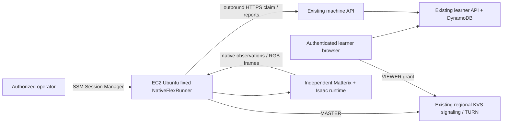

# Current execution note — 2026-10-26

The user has authorized necessary paid commissioning resources and resumed real
Matterix DT delivery. The earlier browser-DT pause no longer blocks this work;
separate signup/two-account acceptance remains outstanding. Development account
`247893369214` and its 8-vCPU Canadian quota were reverified; no active GPU instance
was present before the new guarded build attempt. The
[bounded GPU trial](GPU-CAPACITY-TRIAL.md) now includes the user-authorized G5 fallback
and supersedes the original preference to measure a 64-GiB host first. Build and browser acceptance outcomes must be recorded
separately. No additional Academy account budget should be created.

# Single EC2 GPU pilot: browser → internal Flex simulation

Historical preparation baseline (2026-10-19): the original package created no
resources and selected no account. Resource authorization followed on 2026-10-20;
the 2026-10-23 build attempts failed for insufficient capacity and were reconciled.
Configuration defaults remain disabled. The application's global native-execution
gate must stay false until scene-specific native qualification is recorded.

One Ubuntu GPU host runs `NativeFlexRunner`, one learner at a time, with `num_envs=1`.
The current acceptance target is a saved Flex Workflow Studio design, followed by
a second design with changed layout and volume; see
[Studio native acceptance](STUDIO-NATIVE-ACCEPTANCE.md). The separate fixed
`Matterix-Flex-Mixing-v1` / `mix_four_vials` scene uses seed 42. Each browser view
must show its own run's confirmed observations and real camera frames, then verified
reset and release. OT-2 requires separate native assets and qualification. No physical
instruments are attached; synthetic course success is not native evidence.

## Decision and cost envelope

The original 2026-10-19 preference was **ca-central-1 / g6.4xlarge**: one L4
(advertised 24 GB VRAM), 16 vCPUs and 64 GiB RAM, near the existing Canadian API/KVS.
The 8-vCPU trial first selected **g6.2xlarge**, with the same GPU and 32 GiB RAM.
On 2026-10-26 the user authorized **g5.2xlarge** as a fallback: one full A10G
(advertised 24 GB; EC2 reports 22,888 MiB), 8 vCPUs and 32 GiB RAM. It is offered
in `ca-central-1a` and `1b`; an offering is not a stock guarantee. Both candidates
fit the applied quota and must pass unchanged image and browser gates. G4 is not
enabled pending version/memory compatibility review. None is native-qualified by
its instance specification.

The official Canadian Linux On-Demand feed read on 2026-10-26 lists G5 at
USD 1.34573/hour and G6 at USD 1.08547/hour. A two-hour G5 compute window is about
USD 2.69, before IPv4, storage, media and retained artifacts. The table below
preserves the older planning snapshot.

An L40S alternative is **us-east-1 / g6e.2xlarge**, one GPU with advertised 48 GB
VRAM, 8 vCPUs, 64 GiB RAM. No g6e.2xlarge row was found in the captured Canadian
catalog; this is not proof of permanent regional unavailability or current AZ capacity.
Use the US option only after reviewing data location and additional cross-region
media/control traffic. It does not move the existing API/KVS region automatically.
A100/H100 are not a substitute for the required RTX rendering support.

Historical public Linux On-Demand rates, USD, retrieved 2026-10-19; the AWS feed
publication is 2026-10-15. No Spot, Savings Plans, credits, Free Tier or taxes assumed:

| Region / candidate | Compute/hour | 8 running hours | 40 running hours | 730 running hours |
|---|---:|---:|---:|---:|
| ca-central-1 g6.2xlarge | $1.08547 | $35.12 | $70.02 | $822.44 |
| **ca-central-1 g6.4xlarge** | **$1.46920** | **$38.19** | **$85.37** | **$1,102.57** |
| us-east-1 g6e.2xlarge | $2.24208 | $41.98 | $113.88 | $1,664.37 |

The three right columns include compute + auto-assigned public IPv4 while running
($0.005/hour) + **300 GiB gp3 retained for a whole month**, even when stopped.
Canadian gp3 is $0.088/GiB-month ($26.40/month); US-East gp3 is $0.08 ($24/month).
Use the 8-hour column for a one-day commissioning session with a month of retained
storage; it is not the price of deleting all storage after eight hours.

These are **subtotals, not an all-inclusive quote**. Add KVS active channels,
signaling messages, TURN relay minutes, internet/inter-region transfer, artifact/log
storage, snapshots if requested, image-build compute/storage, software/image fees if
applicable, and existing application usage. No NAT, load balancer, EIP, new VPC or
VPC endpoint is included or created. An existing public subnet and Internet Gateway
route are prerequisites. If policy requires a private subnet, revise networking and
pricing first; do not silently add a NAT gateway.

At an assumed encoded video bitrate of 2–6 Mbps, outbound payload is roughly
0.9–2.7 GB per viewing hour before overhead. Bitrate is an estimate, not measured
traffic. Current media uses aiortc/PyAV; do not assume hardware NVENC encoding just
because the GPU supports it. KVS TURN and internet transfer must be priced in the
**existing KVS region** before approval. AWS's US-East pricing example is $0.03 per
active channel-month, $2.25/million signaling messages and $0.12/1,000 TURN streaming
minutes; those example rates are not a verified Canada quotation.

Stop between sessions. The instance's local NVMe is ephemeral and must not hold the
only copy of its journal or evidence. The root EBS volume is encrypted and retained
on termination; destroying an instance does **not** eliminate that volume's charges.
The `ExpiresOn` tag is an operator review date, not a scheduler or cost cap. There
is no automatic shutdown or budget alarm in this preparation package.

Sources and reproducibility:

- [Captured AWS records, feed metadata, SHA256 and cost arithmetic](evidence/ec2-gpu/prices-2026-10-19.json).
- [AWS EC2 public pricing](https://aws.amazon.com/ec2/pricing/on-demand/),
  [G6 specifications](https://aws.amazon.com/ec2/instance-types/g6/),
  [G5 specifications](https://aws.amazon.com/ec2/instance-types/g5/),
  [G6e specifications](https://aws.amazon.com/ec2/instance-types/g6e/).
- [EBS pricing](https://aws.amazon.com/ebs/pricing/),
  [public IPv4 pricing](https://aws.amazon.com/vpc/pricing/),
  [KVS pricing](https://aws.amazon.com/kinesis/video-streams/pricing/).
- Refresh with `python3 scripts/ec2-gpu-costs.py --output build/ec2-gpu/prices.json`.
  This reads public HTTPS endpoints only. Feed listings do not verify quota or capacity.

## Architecture and independent deployment root



`infra/ec2-gpu/` is a separate Terraform root, with its own lockfile and local state
until an operator explicitly configures a reviewed state backend. The normal
`infra/` apply/release does not recurse into it. `enabled=false` means no data-source
lookups, credentials/account discovery, or managed resources. Offline verification
uses a temporary copy with no operator state and fixed dummy provider credentials.

After authorization, `enabled=true` would create exactly one instance, one security
group, one instance profile/role and the SSM managed-policy attachment. It reuses the
operator-selected VPC/subnet. The provider restricts the approved account; the AMI
lookup requires an exact ID, approved owner, x86_64 and reviewed manifest hash tag.
The instance has a single GPU, no Spot market option and no automatic replacement.
`prevent_destroy` blocks replacement/destruction until a reviewed configuration change.
Changing the worker API or service user-data requires replacement because cloud-init
runs on first boot. `prevent_destroy` blocks that replacement until the operator has
preserved run journals and reviewed the reprovisioning plan; it cannot silently keep
using the old API endpoint.

Security group ingress is empty: no SSH 22, desktop, raw Isaac 49100/47998 or
simulator API is opened to learners. Outbound TCP 443 covers HTTPS/WSS/SSM and
outbound UDP 443 covers KVS TURN; verify returned relay URIs and the actual selected
ICE pair during commissioning. Restricted network ACLs must allow return traffic.
[AWS KVS networking requirements](https://docs.aws.amazon.com/kinesisvideostreams-webrtc-dg/latest/devguide/kvswebrtc-requirements.html).
No arbitrary shell/code or learner-supplied host is accepted by the worker.

The instance role grants SSM access only. It does not grant DynamoDB, worker
qualification, KVS publication, Secrets Manager or application administration.
The worker uses its separate revocable machine token and API-issued run grants.
IMDSv2/hop limit are configured, but do not isolate same-host processes by themselves:
the image must persist `ops/ec2-gpu/block-imds.nft`, denying metadata access to
non-root processes. Prove that the worker user cannot reach metadata while root SSM
still functions. Disable SSM port-forward/session access for learners through IAM.

## Runtime image contract

Do not launch a generic AMI and assume the existing adapter will work. Prepare a
secret-free, x86_64 Ubuntu image after resource authorization, or use a previously
prepared and reviewed image. Its SSM agent must be installed and enabled; no native
worker may be enabled or credentialed in the image. Cloud-init writes the service
and API origin, disables its boot enablement, and starts no runtime.

The reviewed **internal Flex** profile is Python 3.12, Isaac Lab
3.0.0b2.post1, Isaac Sim 6.0.1.0, torch 2.11.0+cu128 and torchvision
0.26.0+cu128. The NVIDIA wheel metadata explicitly pins this Sim version.
Driver 595.58.03 is the version-specific Linux candidate; it remains unmeasured.
The earlier 2.3/5.1 candidate is superseded for this branch. README badges and
old Docker defaults are not compatibility evidence. Exact internal source pins,
wheel hash, source audit and commissioning commands are in [COMMISSIONING.md](COMMISSIONING.md).
This is a source/metadata compatibility assessment, not native qualification.

The image finalizer runs both the fixed scene/render/reset probe and a complete
four-action Studio native probe. They share one 30-minute timeout plus a 30-second
termination grace and an RSS/VRAM/OOM measurement window. Retain the installed
inventory, `scene-render.json`, `studio-probe.json`, `capacity.json`, raw measurement
logs and the Studio report's referenced run artifacts. See
[image build](GPU-IMAGE-BUILD.md) for exact gates. Passing these probes does not
establish browser video, refresh recovery, supervisor/media release or a second run.

Required image layout:

| Path | Contents / authority |
|---|---|
| `/opt/academy-agent` | Separate pinned Academy release and Python 3.12 venv, frozen `uv.lock`, `native-worker` extra |
| `/opt/matterix-isaac/bin/python` | Prepared Python 3.12 runtime with the pinned Isaac pair |
| `/srv/matterix` | Independent clean Matterix checkout, exact reviewed commit |
| `/srv/matterix-assets` | Independent clean tracked asset data; adjust source layout before image review if needed |
| `/etc/academy-native/image-manifest.json` | Completed reviewed manifest, no secrets |
| `/etc/academy-native/native-config.json` | Generated fixed runner configuration, root-owned 0644 |
| `/etc/academy-native/worker.env` | Root-owned 0600 machine API origin, no token |
| `/etc/academy-native/worker.token` | Absent from the image; installed after separate enrollment, root-owned 0600 |
| `/var/lib/academy-native` | Systemd StateDirectory, 0700, durable journal/run artifacts on EBS |
| `/run/academy-native` | Systemd RuntimeDirectory, 0700, transient RGB frame files |
| `/var/cache/academy-native` | Writable shader/runtime cache and service HOME, 0700 |

Create a dedicated non-login `academy-native` user/group and `video`/`render` device
groups. Root-owned code/checkouts must be readable by that user. Add only the two
exact root-owned checkout paths to system Git `safe.directory`; never use `*`.
After reviewing software terms, initialize EULA/extension/shader caches under the
service identity with `HOME=/var/cache/academy-native`; do not discover first-run
prompts in the unattended worker (its stdin is closed). Configure asset resolution
to the pinned asset root. Ensure all assets required for
cold start are accessible over HTTPS or baked in, with redistribution/license terms
reviewed. No runtime or binary is copied into this repository.

The image's persistent nftables configuration must include the IMDS block rules;
ensure its boot service loads them before native execution. GPU nodes remain
accessible; `PrivateDevices` is intentionally not enabled. The supplied systemd
unit limits writes to state/runtime/cache and private temporary files. If Isaac
tries writing elsewhere, relocate that cache in the prepared image and re-test;
do not disable all filesystem restrictions by default. Native and media processes
currently share the service Unix identity and can read its credentials/run grants.
This is a trusted fixed-code pilot, **not a sandbox for learner-supplied programs**.
Stronger per-process credential isolation remains separate work.

Complete `ops/ec2-gpu/image-manifest.example.json` in a protected build directory.
Empty commits/driver intentionally prevent rendering. All code, asset and Lab
source commits must be exact 40-character SHAs from the artifacts being reviewed.
The `status` must stay `prepared-not-qualified`; controls remain `[]` because the
current adapter explicitly rejects pause/resume/cancel.

```sh
uv run python scripts/ec2-gpu-prepare.py \
  --manifest build/ec2-gpu/image-manifest.json \
  --output-dir build/ec2-gpu/rendered
```

This writes only configuration and the exact manifest-file hash; it neither builds
nor qualifies anything. Install the exact manifest bytes and generated config in
the image; tag the resulting AMI `AcademyManifestSHA256` with that hash. Inspect its
architecture, driver, package versions, EBS root size, clean commits, and cold boot.
Set the AMI ID/owner/hash in the reviewed Terraform variables. Never put a Git
credential, worker token, presigned URL or learner data in AMI, Terraform, user data
or Git. Enrollment uses the existing `academy.worker_admin enroll` with an explicitly
approved account/table and exact engine/assets; it registers a quarantined worker.
Preserve its protected credential file if a response is lost. Securely install it
on the host as root without terminal/SSM command logging its contents, then remove
unneeded delivery copies according to the lab's credential procedure.

The pilot uses `academy.native_runner` directly, with local operator-reviewed config;
it does not require the proposed new pairing/remote-install channels or write a
`native_config` registry field for `host_agent`. Do not also start the old user
agent/generic gateway service: only this service may own this journal/worker identity.
After draining runs, use `systemctl start/stop academy-native` through SSM as needed.
Boot enablement is an explicit operator decision after qualification.

## Preparation checks (safe to run now)

```sh
bash scripts/verify-ec2-gpu.sh
uv run pytest -q app/backend/tests/test_ec2_gpu_preparation.py
```

The verifier runs format/init/validate and a disabled, refresh-free plan in a fresh
temporary copy. It explicitly overrides ambient `TF_VAR_enabled`, ignores credential
profiles and asserts zero resources. It does not apply or select an AWS account.
Provider download and public pricing requests are ordinary public HTTPS reads.
`scripts/verify.sh` includes this verification to prevent the separate root drifting.
Do not run the existing `scripts/probe-kvs.py` in this preparation phase: it creates
a temporary billable signaling channel.

## Authorized deployment and acceptance sequence

The existing authorization covers the bounded build and single-host commissioning
in the verified development account. Recheck live identity, network, quota and
credential lifetime before executing. A successful build must supply the actual
AMI ID and evidence; do not infer them from a configuration or a launch attempt.

1. **Review account, network, quota and spending window.** Operator checks STS
   identity against the approved account, instance-type offerings for the selected
   subnet AZ, G/VT On-Demand vCPU quota (8 for g5.2xlarge or g6.2xlarge), capacity, SSM policy,
   Internet Gateway and ACLs. A price entry is not capacity evidence. Review the
   existing application's native gate, learner access and KVS region. Choose a
   maximum running-hours window and stop operator; no automated cost cap exists.
2. **Build/review image.** Package the exact tested Academy commit into a new
   protected directory, retain dependency/source pins and verify input hashes.
   Use the guarded build wrapper and retain both native probe reports and capacity
   measurements. A local source export does not build an AMI.
3. **Review the isolated plan.** Copy `pilot.tfvars.example` to a local ignored
   variable file, resolve every empty input, and only then set `enabled=true`.
   Initialize the chosen state location and inspect a saved plan. It must contain
   one GPU instance and its IAM/security group only. No existing Academy resource,
   DNS, learner auth, production gate or unrelated network may change. Applying
   that reviewed plan must use the verified image and preserve the one-GPU limit.
4. **Prove host readiness.** Through SSM, record Ubuntu/kernel/architecture,
   `nvidia-smi` GPU/driver/VRAM, installed Sim/Lab/Python versions, launcher argument
   compatibility and task imports. As the service user, run `NativeConfig.verify()`
   against the installed config. Check readable clean repository pins, asset paths,
   writable cache/state, free EBS, cold-start extension dependencies, IMDS denial,
   SSM functionality and no duplicate worker service. An environment probe alone
   is not a passing native test.
5. **Bounded browser commissioning.** Follow
   [Studio native acceptance](STUDIO-NATIVE-ACCEPTANCE.md): a passing host inventory
   permits a grant for one JWT subject, one worker, exactly two approved saved plans
   and at most one hour. Run both plans through the real browser, including refresh
   recovery and the changed tip-rack slot and volume. The worker stays unqualified
   and the global execution gate stays disabled. Collect actual decoded relay video,
   native snapshots, reset/release receipts and the owner-scoped cloud report.
   [COMMISSIONING.md](COMMISSIONING.md) covers the separate fixed mixing acceptance.
6. **Review qualification.** The offline evidence checker never qualifies a worker.
   Review image identity, isolation, interruption/recovery and cleanup evidence against
   [WORKER-CONTROL.md](WORKER-CONTROL.md) before separately using worker_admin qualify.
   General learner enablement remains a separate reviewed application deployment.
7. **General learner enablement.** Enable only the scenes covered by reviewed
   qualification. Verify the deployed browser and API retain the same source/scene
   bindings and fail closed for unsupported designs. A visible animation alone
   does not establish qualification.
8. **Drain, stop and reconcile costs.** Wait for verified cleanup and a free worker;
   stop the native service and EC2. Never stop it to resolve an unknown outcome.
   Keep journal/config/evidence for recovery. Verify stopped state and continuing
   EBS charges. Re-enable only after rechecking pins, credentials and service state.
   To retire, revoke the worker, reconcile any run, retain/export necessary evidence,
   explicitly review removal of `prevent_destroy`, and separately account for the
   retained EBS volume, snapshots, image storage and KVS channels. Do not bulk-delete
   run directories or replay interrupted execution to recover.

## Browser/native acceptance matrix

Start from `ops/ec2-gpu/acceptance-record.example.json` (all gates pending). It is
intentionally **not** accepted by `worker_admin qualify`.

| Gate | Action | Required evidence / failure behavior |
|---|---|---|
| Exact intent | Submit each approved saved Studio design once | Cloud run ID, full saved plan hash, layout, ordered actions, worker/native IDs and source pins agree; fixed mixing uses its separate seed-42 plan |
| True observations | Run full workflow | Every saved action confirmed once in order, terminal native snapshot and native-semantic liquid/tip observations; mixing additionally requires its five actions and lid observations |
| Video binding | Open live viewport | Real 960×540 camera frames for that same native session; selected relay ICE connection and run-scoped viewer grants; stale frames never establish progress |
| Refresh/reconnect | Close/reopen or interrupt browser network | Same original run; no second submission, launch or advance caused by browser polling; confirmed state retained |
| Lost receipt/restart | Supervised interruption at a journaled boundary | Original IDs queried, no duplicate native side effect; uncertainty quarantines instead of retrying |
| Isolation | Second learner tries to read/control/view first learner's run | Denied; no host/credentials/grants leak; only one active native lease on the host |
| Unsupported controls | Inspect/push pause/resume/cancel | UI/API do not promise unsupported controls; forced host interruption is operator recovery, not clean cancel |
| Cleanup/reuse | Inspect reset/release, then run the changed second Studio design | Object/liquid/tip/controller reset checks, process/media stopped and release receipt bound to original IDs; second run has fresh scene state and the approved changed slot/volume |
| No hardware / no synthetic substitution | Inspect all outputs and fault state | GPU simulation only; no physical authority; fault never becomes a synthetic success |
| Stop/accounting | Drain and stop | Host stopped, no orphan native process, record retained storage and media costs; ExpiresOn tag alone does not count |

Retain an operator report with time, instance/AMI/manifest, run/native IDs, version
pins, native snapshots, reset/release receipts, browser observations and measured
startup/RSS/VRAM/frame/network data. Hash artifacts and record their protected
locations. Raw worker tokens, publisher grants, TURN credentials, signed URLs and
journals containing claim tokens must not be committed or attached to learner
reports. Use sanitized extracts; preserve protected originals for reconciliation.

## Evidence boundary

Account/quota checks, source packaging, a GPU launch, image probes and browser
commissioning are distinct evidence stages. Record the current attempt's outcome
before claiming a built image or accepted browser DT workflow. The build attempt
does not yet establish native observations, real browser frames, recovery,
reset/release or a second run. No stage establishes physical operation or a cost cap.
See [STATUS.md](STATUS.md) and dated deployment records for application evidence.

The original preparation tests established configuration contracts and zero-resource
defaults only. That dated local verification passed 436 backend
tests (19 new preparation tests), Lambda packaging, frontend build/format, and
both Terraform validations including the zero-resource disabled plan. See the
[dated local validation record](VALIDATION.md).
