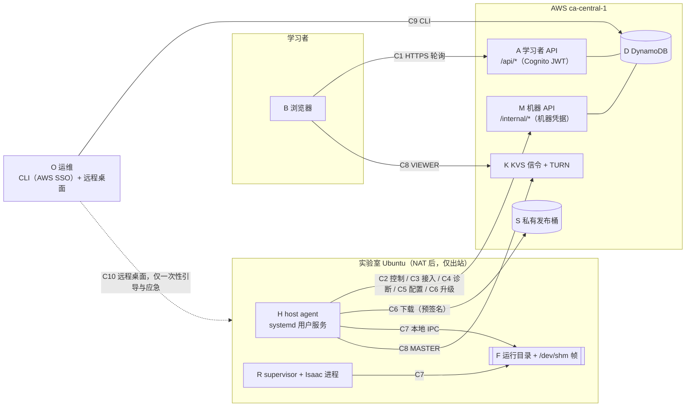
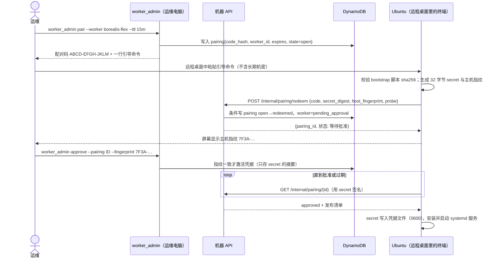

# 端点通信设计：不依赖 SSH 的仿真主机接入

状态：设计提案（2026-10-16），尚未实现。本文是 [ACCESS-MODEL.md](ACCESS-MODEL.md)（权限与信任区）和 [WORKER-CONTROL.md](WORKER-CONTROL.md)（已实现的 worker 控制平面）的下一层：把系统拆成端点，逐条定义每条通道的方向、鉴权、消息、幂等规则和失败行为。重点是解决当前的卡点：**运维无法可靠地把 agent 装到实验室 Ubuntu 上，装上以后也看不到它的状态。**

已实现的通道照现状描述；标 **NEW** 的是本文新提出的。

## 1. 卡点是什么

截至 2026-10-01 的事实（见 `.planning/2026-10-01-flex-live-sim`）：

| 现象 | 后果 |
|---|---|
| Tailscale SSH 拒绝运维账号 `sissi`，只能经远程桌面看主机屏幕 | 没有可脚本化的远程 shell；安装、排错全靠在远程桌面里手工粘贴命令 |
| 安装命令内嵌一个 1 小时有效的 S3 预签名 URL，机器凭据随安装包下发 | 链接很快过期；凭据以文件形式经过运维 Mac，再进安装包 |
| 安装后，云端只能看到一次性上传的环境 probe | 运维不知道 agent 是否在跑、配置校验为什么失败、日志说了什么 |
| Isaac Lab 的 Python 在 `/home/steven/anaconda3/...`，Matterix checkout 在 `/home/sissi/...`；以 `sissi` 运行时 Git 报 ownership 检查失败 | `NativeConfig.verify()` 依赖 `git rev-parse`，因此一定失败，worker 永远无法通过配置校验 |

问题的本质是：**主机和运维之间缺一条可靠、可观测、不依赖入站访问的通道。** 现在依赖的 SSH 被拒，而远程桌面只适合人眼看，不适合自动化。

设计目标：

1. 主机上的人工操作压缩到**一次**：在远程桌面里打开终端，粘贴一行命令，核对屏幕上的指纹。
2. 之后的安装状态、配置、诊断、升级全部走 agent 的出站 HTTPS 通道，运维在自己电脑上用 CLI 完成。
3. 云端永远不向主机下发 shell 命令或代码，只下发**固定枚举的请求**和**经运维审核的配置数据**。
4. SSH / Tailscale 变成可选的应急手段，不再是前置条件。

## 2. 端点



| 端点 | 身份 | 运行位置 | 能主动连接谁 |
|---|---|---|---|
| B 浏览器 | Cognito 用户 | 学习者设备 | A、K（VIEWER） |
| A 学习者 API | Lambda 执行角色 | AWS | D、K 控制面 |
| M 机器 API | Lambda 执行角色；调用者是 worker 机器凭据 | AWS | D、S（签发预签名 URL）、K 控制面 |
| H host agent | worker 机器凭据（每台主机一个） | Ubuntu，systemd 用户服务 | M、S、K（MASTER） |
| R supervisor + Isaac | 不持有任何云端凭据 | Ubuntu，H 拉起的子进程 | 只读写 F |
| O 运维 | AWS SSO 角色 | 运维电脑 | D（经 `worker_admin` CLI）；远程桌面 |

一条硬规则：**R 不联网，也不持有凭据。** 所有云端通信都由 H 代理，Isaac 进程即使被学员输入影响，也拿不到任何 token。

## 3. 通道总表

| # | 通道 | 方向 | 传输 | 鉴权 | 状态 |
|---|---|---|---|---|---|
| C1 | 学习者读写 | B → A | HTTPS，约 2 秒轮询 | Cognito JWT + scope | 已实现 |
| C2 | 运行控制 | H → M | HTTPS，短轮询 + 事件推送 | 机器凭据 + claim_token | 已实现 |
| C3 | 主机接入（配对） | H → M | HTTPS | 一次性配对码 → 机器凭据 | **NEW**（替换预签名凭据下发） |
| C4 | 健康与诊断 | H → M | HTTPS，每 60 秒 + 按需 | 机器凭据 | **NEW**（扩展现有 probe） |
| C5 | 配置提议与下发 | H ↔ M | HTTPS | 机器凭据；下发需运维批准 | 部分已实现（下发），提议为 **NEW** |
| C6 | agent 自升级 | H → M、S | HTTPS + 预签名下载 | 机器凭据；sha256 校验 | **NEW** |
| C7 | 本地 IPC | H ↔ R | 运行目录文件 + 共享内存 | 文件权限 0700/0600 | 已实现 |
| C8 | 画面 | H → K ← B | WebRTC，仅 TURN 中继 | KVS MASTER / VIEWER 授权（按运行签发） | 已实现，未见真实帧 |
| C9 | 运维管理 | O → D | AWS API | AWS SSO + 账号校验 | 已实现，扩展为 **NEW** 子命令 |
| C10 | 远程桌面 | O → 主机 | Tailscale | Tailscale 身份 | 现有；降级为一次性引导与应急 |

主机需要的网络只有：出站 TCP 443 到 `*.execute-api.ca-central-1.amazonaws.com`、`*.s3.ca-central-1.amazonaws.com`、`*.kinesisvideo.ca-central-1.amazonaws.com`，以及 KVS TURN（UDP 优先，TCP/TLS 443 兜底）。不需要任何入站端口。

## 4. 共同的消息规则

所有 H → M 请求遵守同一组规则。现有 C2 已经满足，新通道照此实现：

1. **身份只来自凭据。** 请求体里不能出现 `worker_id`、`qualified`、`scenes` 等字段；即使出现也被拒绝（`StrictModel`，`extra="forbid"`）。
2. **每个会改变状态的请求带 `request_id`（UUID）。** 服务器按 `(worker_id, request_id)` 去重：同 ID、同内容返回原结果；同 ID、不同内容返回 409。
3. **带期望版本。** 改记录的请求携带 `expected_version`，冲突返回 409，客户端先读后再决定，不盲目重发。
4. **服务器时间为准。** 响应里带 `server_time`；租约、过期一律按服务器时间判断，主机时钟漂移不影响正确性。
5. **重试分级：**

| 类别 | 例子 | 自动重试 |
|---|---|---|
| 只读 | `GET /internal/workers/me`、`GET .../configuration`、`GET /internal/runs/{id}` | 可以，指数退避 |
| 幂等写 | 心跳、同 sequence 的快照、健康报告、诊断结果 | 可以，用同一个 `request_id` |
| 有副作用且不可重放 | 启动原生进程（`start` 之后的 launch） | **不可以**。先写本地 journal 和 `launch-intent`，丢失响应时只读回状态 |

6. **大小上限。** 单个请求体不超过 32 KB（现有 probe 已如此），日志片段另有更小的上限（§5.3）。
7. **不回显敏感输入。** 校验失败的错误信息不复述请求内容（现有 `worker_admin` 已如此处理 Pydantic 错误）。

## 5. 新通道设计

### 5.1 C3 主机接入：配对码代替凭据文件 **NEW**

现状：运维在自己电脑上 enroll，生成凭据文件，打进安装包，上传到 S3，再把 1 小时有效的预签名命令发给主机。凭据要经过多处，链接也很快过期。

改为类似设备授权码的流程（参考 OAuth device flow）：凭据**在主机上生成并只留在主机上**。



要点：

- **配对码**：12 个字符（去掉易混淆字符），15 分钟内单次有效，服务器只存哈希。`redeem` 端点不需要机器凭据，所以按来源 IP 和全局严格限速（例如每分钟 5 次），失败次数达到上限即作废该配对。
- **secret 在主机生成**，云端只存摘要。即使配对码被截获，攻击者也需要运维核对屏幕上的指纹并批准，才能拿到激活的身份。
- **指纹**：`sha256(machine-id || secret_digest)` 的前 16 个十六进制字符。远程桌面里看到的值和 CLI 显示的值一致，运维才批准。
- **引导命令**里只有：bootstrap 脚本的公开下载地址、它的 sha256、配对码、API 地址。没有长期机密，过期也没关系，重新 `pair` 即可。
- 现有 `worker_admin enroll` 留作兜底，不删除。

### 5.2 C5 配置：主机提议，运维批准，agent 应用 **NEW（提议部分）**

现状：运维手写 `NativeConfig` JSON（Python 路径、Matterix 和资产路径、两个 40 位 commit），写进 worker 记录，agent 再拉取。手写容易出错，而且运维看不到主机上实际有什么。

改为：

1. agent 的 probe 已经能发现 Python 环境和 Matterix checkout。新增 `POST /internal/workers/config-proposal`，agent 根据 probe 提交一份**候选配置**，并附上每个字段的校验结果。
2. 运维执行 `worker_admin config review --worker X`，看到候选配置与当前配置的差异和每项校验结果，确认后执行 `worker_admin config approve --proposal ID --expected-version N`。
3. agent 从 `GET /internal/workers/configuration` 拿到已批准的配置，本地再跑一次 `verify()`（现有逻辑），把结果通过 C4 报告回来。

云端下发的始终是**数据**（路径、commit），不是命令。agent 只把它交给固定的 `NativeFlexRunner`（现有 `host_agent.configured_runner` 已如此）。

### 5.3 C4 健康与诊断 **NEW**

现状只有一次性 probe。新增两部分。

**(a) 周期健康报告** `POST /internal/workers/health`，每 60 秒一次，状态变化时立即发送：

```json
{
  "request_id": "…",
  "agent_version": "9840ed7",
  "observed_at": "2026-10-16T14:00:00Z",
  "service": {"state": "running", "restarts": 0, "uptime_s": 3600},
  "config": {
    "state": "invalid",
    "checks": [
      {"code": "GIT_UNSAFE_OWNERSHIP", "path": "/home/sissi/IsaacLab/Matterix/Matterix"},
      {"code": "PIN_MATCH", "ok": true}
    ]
  },
  "runtime": {"gpu": "NVIDIA RTX …, 550.xx", "display": ":1", "disk_free_gb": 210},
  "journal": {"active_run": null, "last_step": "idle"},
  "last_error": {"code": "CONFIG_VERIFY_FAILED", "at": "…"}
}
```

`checks[].code` 是固定枚举，运维看到就知道该怎么处理：

| code | 含义 | 处理（见 §6） |
|---|---|---|
| `GIT_UNSAFE_OWNERSHIP` | checkout 属于另一个用户，Git 拒绝读取 | 使用 worker 自有的固定 clone，或精确路径的 `safe.directory` |
| `CHECKOUT_DIRTY` / `PIN_MISMATCH` | 有未提交改动 / HEAD 与固定 commit 不一致 | 不要在共享 checkout 上运行，改用固定 clone |
| `ASSETS_UNTRACKED` | USD 数据含未跟踪的文件 | 清理或重新资格认证 |
| `PYTHON_MISSING` / `ISAAC_IMPORT_FAILED` | Isaac 的 Python 不可用 | 修复环境，或授予 worker 用户读取和执行权限 |
| `GPU_UNAVAILABLE` / `DISPLAY_MISSING` | 没有 GPU 或 DISPLAY | 检查驱动和会话 |
| `CLOCK_SKEW` | 主机时间与 `server_time` 相差超过 60 秒 | 启用 NTP |

**(b) 按需诊断**，固定枚举、无 shell：

- 运维：`worker_admin diagnose --worker X --kind {reprobe|verify_config|log_tail|gpu_check|network_check}`。服务器在 worker 记录上写入 `diagnostic_request {id, kind, expires}`。
- agent 下次读取 configuration 时看到请求，执行**内置的固定实现**，把结果 `POST /internal/workers/diagnostics/{id}`。
- `log_tail` 最多 200 行、16 KB，上传前过滤：匹配 token 模式、`Authorization`、AWS 密钥格式和 URL 查询串的内容一律替换为 `[redacted]`。
- `network_check` 只测本文 §3 列出的固定目标（DNS 解析、TLS 握手、TURN 可达性），不接受任意主机名。
- 结果保存 7 天，`worker_admin diagnose --show ID` 读取。

这样，没有 SSH，运维也能回答“agent 跑了吗、卡在哪、日志说什么、网络通不通”。

### 5.4 C6 agent 自升级 **NEW**

- `GET /internal/releases/agent` 返回 `{version, sha256, url}`，其中 `url` 是 5 分钟有效的 S3 预签名地址，**只发给已认证的 worker**。
- agent 只在空闲时升级：journal 没有活动运行，worker 状态不是 `busy`。
- 流程：下载 → 校验 sha256 → 解压到 `releases/<version>/` → 用 `uv sync --frozen` 建 venv → 原子切换 `current` 符号链接 → 重启自身服务 → 通过 C4 报告新版本。新版本 3 分钟内健康报告不正常，就切回上一个版本，并报告 `UPGRADE_ROLLED_BACK`。
- 发布清单由运维 CLI 写入（`worker_admin release-agent --commit … --sha256 …`），并与 GitHub CI 的 release manifest 对应。主机不会自己“追最新版”。
- 升级 agent 不会改变 Matterix 和资产的固定 commit。那两者属于资格认证范围，改动需要重新认证。

### 5.5 C2 控制通道的补充

已实现的端点不变（claim / start / binding / heartbeat / snapshots / unknown / cleanup / publisher / viewers）。补充两点：

- 心跳响应里同时返回 `control`（暂停、取消请求）、`diagnostic_request` 和 `agent_release`，agent 空闲时一次请求就拿全，不必分别轮询多个端点。
- 本轮已实现的 `native_plan.py` 提供学习者计划的能力预检：提交和领取时都会检查，不支持就明确拒绝。后续给 first-transfer 写原生执行器时，`NativeTransferIntent` 就是 H 交给 R 的输入格式，写进 `manifest.json` 的 `request` 旁边。

## 6. 解决运行时归属问题（Git ownership）

不建议在别人日常使用的 checkout 上直接跑资格认证过的运行：那份 checkout 随时可能被改动，`CHECKOUT_DIRTY` 和 `PIN_MISMATCH` 迟早会出现。

推荐做法：一次性准备一份 **worker 自有、固定在某个 commit 的只读 clone**。

```text
/home/sissi/.local/share/lab-onboarding/runtime/
  matterix/<engine_sha>/    ← git clone --no-hardlinks <现有 checkout> && git checkout <sha>
  assets/<asset_sha>/       ← 同上
```

- 由 agent 用 C4 的诊断请求 `prepare_runtime`（在 §5.3 枚举基础上新增一项）执行：参数只能是**已批准配置里的 commit**，来源只能是 probe 发现的本地 checkout 路径。clone 完成后校验 HEAD 和工作区干净，再设为只读。
- 如果来源 checkout 本身无法读取（属于 `steven`，`sissi` 没有读权限），agent 报告 `SOURCE_UNREADABLE`。这时需要主机所有者做一次授权：给 `sissi` 授予该目录的读权限，或者由所有者执行一次 clone。这是唯一必须在主机上由人完成的权限操作，命令会写进诊断结果里供复制。
- 只有在无法另建 clone 时，才退而在 worker 用户的 `~/.gitconfig` 里给**精确路径**加 `safe.directory`。绝不使用 `safe.directory=*`。
- Isaac 的 Python 环境（`/home/steven/anaconda3/envs/isaaclab`）同理：agent 只需要读和执行权限，不修改它。没有权限时报告 `PYTHON_MISSING`，附需要的权限说明。

## 7. 本地 IPC（C7）约定

已实现，这里写明约定，供后续 first-transfer 执行器遵守：

| 文件 | 写入方 | 读取方 | 语义 |
|---|---|---|---|
| `binding.json` | H | H | 分配身份；恢复时必须一致 |
| `manifest.json` | H | R | 固定配置 + 绑定 + `RemoteRunRequest`（将来加 `native_intent`） |
| `launch-intent` | H（`O_EXCL` 创建） | H | 存在即表示可能已启动，**永不重放** |
| `snapshot.json` | R | H | 累积快照，单调 sequence；H 用 `check_run_snapshot` 校验后才推送 |
| `fault.json` | R | H | 进程故障，转为 `outcome_unknown` 或 `failed` |
| `cleanup-request.json` / `released.json` | H / R | R / H | 带 command_id 的重置与释放回执 |
| `/dev/shm/lab-onboarding/<session>.rgb` | R | H（媒体发布器） | 帧缓冲，带 tick |

规则：每个文件只有一个写入方；写入一律“写临时文件 + rename”，保证原子；目录 0700、文件 0600。

## 8. 失败行为矩阵

| 故障 | 学习者看到 | 系统行为 |
|---|---|---|
| 主机与 AWS 断网 | Reconnecting，最后确认状态和时间戳 | R 继续本地执行，H 本地累积快照；恢复后按 sequence 补推。租约过期则运行进入 `outcome_unknown`，**不重跑** |
| H 崩溃或重启 | 同上 | systemd 拉起；按 journal 和 `launch-intent` 只读恢复 |
| Isaac 崩溃 | Failed 或 Outcome unknown | R 写 `fault.json`；需运维 reconcile 后才能释放 |
| KVS 不可用 | 视频断开标识；状态照常更新 | 状态通道不依赖媒体；视频永远不用于确认步骤完成 |
| A / M 暂时不可用 | 浏览器显示连接问题 | H 退避重试只读和幂等请求；不重放 launch |
| 配对码泄露 | 无 | 15 分钟过期、单次使用、需核对指纹才能激活 |
| agent 升级失败 | 无 | 自动回滚，报告 `UPGRADE_ROLLED_BACK` |
| 主机配置被人改动 | 无（该主机不再领取任务） | `verify()` 失败，报告 `PIN_MISMATCH`，worker 自动隔离 |

## 9. 新增端点清单

| 端点 | 调用方 | 鉴权 | 说明 |
|---|---|---|---|
| `POST /internal/pairing/redeem` | 引导脚本 | 配对码（严格限速） | 提交 secret 摘要、指纹、初始 probe |
| `GET /internal/pairing/{id}` | 引导脚本 | 用 secret 签名的请求 | 等待批准，拿到激活状态和 agent 发布清单 |
| `POST /internal/workers/health` | H | 机器凭据 | 周期健康报告 |
| `POST /internal/workers/config-proposal` | H | 机器凭据 | 根据 probe 提交候选配置 |
| `POST /internal/workers/diagnostics/{id}` | H | 机器凭据 | 回传按需诊断结果 |
| `GET /internal/releases/agent` | H | 机器凭据 | agent 发布清单 + 短时效下载地址 |

新增运维 CLI 子命令：`pair`、`approve`、`status`、`config review` / `config approve`、`diagnose`、`release-agent`。

Terraform 改动：`/internal/pairing/*` 路由使用单独的限速设置；新增 `system#pairings`、`system#health`、`system#diagnostics` 三个分区（同一张表）；预签名下载的 IAM 权限只限 agent 发布前缀。

## 10. 实施顺序

1. **C4(a) 健康报告 + `worker_admin status`**：改动最小，立刻让运维看到现有 agent 的状态和 `GIT_UNSAFE_OWNERSHIP` 这类原因码。
2. **C4(b) 按需诊断**（含 `log_tail`、`network_check`、`prepare_runtime`），解决 §6 的归属问题。
3. **C3 配对**：替换预签名凭据下发；之后主机上的人工操作只剩一次粘贴和一次指纹核对。
4. **C5 配置提议**。
5. **C6 自升级**：之后修复不需要再登录主机。
6. 以上全部就绪后，回到 [SYNCHRONIZED-RUNS.md](SYNCHRONIZED-RUNS.md) 的验收场景，先完成 `mix_four_vials` 的资格认证，再写 first-transfer 原生执行器（输入为 `NativeTransferIntent`）。

## 11. 仍需要人在主机上完成的事

无论采用哪种设计，下面这些都绕不过去：

- 第一次：在远程桌面里打开终端，粘贴引导命令，核对指纹。
- 如果来源 checkout 或 Isaac 环境属于其他用户，需要所有者授予读权限（一次）。
- GPU 驱动、显示会话、NTP 这类系统级问题，由主机管理员处理。

如果实验室管理员愿意给 `tag:operator` 开 Tailscale SSH（ACL 示例见 ACCESS-MODEL.md §9.4），排障会更快；但本设计不再把它当作前提。
