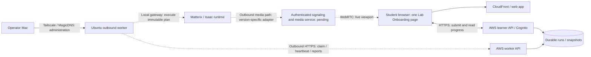

# Live Isaac viewport: topology review and integration sequence

Reviewed 2026-10-01. This is an integration plan, not a native execution or streaming acceptance record. Product name: **Lab Onboarding**.

## Requirement

Show the actual Matterix / Isaac simulation **while a saved experiment runs**, inside the existing web run page, beside progress and native observations for that same run. Keep the existing React frontend. Use an embedded WebRTC viewer for the Isaac-rendered viewport; a new Three.js scene is not needed to satisfy this request.

This request prioritizes the real viewport ahead of the longer-term browser-rendered twin proposed in [ACCESS-MODEL.md, section 6](ACCESS-MODEL.md). The student experience is a scoped simulation view, with camera interaction only when the server can enforce it. General desktop and Isaac editor access stay with the operator.

## What was checked

The separate Codex task **评估 deploy 合理性** uses the same checkout at `/Users/sissifeng/matterix-academy`; this repository currently lists only that Git worktree. Its deployment and automatic-release work is ongoing. This review does not change that task's implementation files or cloud resources.

| Boundary | Evidence on 2026-10-01 | Limit |
|---|---|---|
| Local Tailscale | Client running; MagicDNS enabled; suffix `tail6a1dd7.ts.net` | Does not prove application ports or SSH permissions |
| Workstation network | `sdl0-robot-borealis.tail6a1dd7.ts.net` resolves to `100.119.227.39`; one Tailscale ping succeeded in 6 ms over a direct path | A single network sample is not streaming latency or throughput acceptance; the running Isaac process was not inspected |
| AWS learner API | Read-only `get-function-configuration` returned `matterix-academy-dev`, `State=Active`, `ACADEMY_REMOTE_ENABLED=false` | No native execution was enabled or attempted |
| AWS control plane | [Deployment record](DEPLOYMENT-2026-10-01.md) reports the deployed API, queue, machine authorization and lease reaper | Deployment evidence explicitly excludes native Ubuntu/GPU/media acceptance |
| Native runtime and media | [Worker handoff](WORKER-CONTROL.md) and [synchronized-run contract](SYNCHRONIZED-RUNS.md) still require native qualification and authenticated media | No verified installed gateway, live stream, or viewer grant endpoint |

No SSH login, runtime restart, Tailscale policy change, port exposure, worker enrollment or new AWS resource was performed in this review.

## Topology to preserve

Solid connections below describe the existing access design; dashed connections are native/media integration still to qualify. The worker software exists, but its installation on the Ubuntu host is not verified.

The command/status path and the media path share a run binding, not a transport. CloudFront and the current HTTP API do not themselves relay Isaac's WebRTC media. The AWS control plane does not need to join the tailnet or dial the Ubuntu host.

### Tailscale and MagicDNS

- **Tailscale** provides the operator's private route to the workstation.
- **MagicDNS** names devices on that network. A DNS name is not an authenticated public streaming endpoint. An ordinary student browser outside the tailnet cannot gain that route merely by loading the AWS website. See [MagicDNS](https://tailscale.com/docs/features/magicdns).
- **Serve** publishes services within the tailnet; it does not fulfill the no-student-VPN requirement. See [Tailscale Serve](https://tailscale.com/docs/features/tailscale-serve).
- **Funnel** publishes a service to the internet using a TCP proxy. It does not automatically carry the separate Isaac media transport or enforce Lab Onboarding run permissions. The existing plan does not select Funnel. See [Tailscale Funnel](https://tailscale.com/docs/features/tailscale-funnel).
- The ACL in ACCESS-MODEL.md is an example, not verified live policy. Peer visibility and a successful Tailscale ping do not establish SSH, RDP, or streaming-port access.

### Remaining media transport decision

Preserve the existing rule: no public inbound application ports on the lab host and no student tailnet membership. The media implementation must therefore prove an outbound route for **both signaling and media**, using an authenticated media service plus a host-side adapter as required by the installed Isaac version. TURN may relay media, but cannot by itself create the signaling route, bind streams to runs, or enforce viewer permissions.

Do not assume a reverse HTTPS proxy, a TURN installation, or an iframe is a complete solution. First test the installed runtime's transport capabilities. If its built-in streaming server cannot satisfy outbound-only delivery, select and validate an explicit host-side media bridge; do not silently change the network boundary.

The [official NVIDIA browser client](https://docs.isaacsim.omniverse.nvidia.com/latest/installation/manual_livestream_clients.html) and [Omniverse Web SDK](https://docs.omniverse.nvidia.com/ov-web-sdk/latest/index.html) are the integration starting points. Pin the client to the actual runtime/extension compatibility. The screenshot's **Isaac Lab 3.0.0** label does not identify the Isaac Sim/Kit version. Current NVIDIA documentation permits one direct streaming client per Isaac instance, so start with one active learner and a queue. Multiple simulated environments in one viewport are not isolated student streaming sessions.

## Implementation sequence

1. **Inspect the installed host without disturbing its current run.** Confirm the intended workstation, SSH account, Matterix/assets commits, Isaac Lab/Sim/Kit and streaming-extension versions, GPU encoding support, launch command, current process and available ports. Record the facts before choosing a streaming client or launcher flag. A finite smoke-test script is not a persistent session service.
2. **Prove one private live viewport.** Use the operator's existing network access to test the actual Matterix scene, first rendered frames and reconnect. This validates runtime/client compatibility only; it is not student web delivery acceptance.
3. **Complete native execution binding.** Install and qualify the documented outbound worker and local gateway. Execute the saved immutable plan in the allocated runtime; report native observations, confirmed actions, and verified reset/release. Do not enable learner execution until the native contract passes.
4. **Prove browser-only media delivery.** Implement the authenticated signaling/media path and any required host adapter. Test from a browser outside the tailnet. The service must admit only the authorized run, expire/revoke viewers, and remain unable to expose a general desktop or editor input. Use view-only mode first if server-side camera restrictions are not yet available.
5. **Embed the viewer beside progress.** Add a viewport to the existing remote run panel. Bind every grant to the authenticated owner, Academy run/session, native session, and current runtime generation. Reject a stream for an old allocation. Display video connectivity separately from snapshot freshness; missing frame timestamps must not be replaced by invented latency values.
6. **Accept the complete path.** Run the 100 µL lesson and 50 µL variation. Confirm the submitted volume/layout reaches that runtime, its live viewport appears during execution, and native reports drive progress. Reconnect without rerunning actions. Reject another user's media grant, revoke an expired viewer, test runtime replacement and stale updates, and verify reset before the next learner.

## Run-page behavior

The viewport is the main visual area; confirmed steps and observed quantities remain visible beside it. Queued/starting sessions show explicit preparation states. If the video drops but status is fresh, show **Video disconnected** while retaining native progress. If status is stale but video continues, show **Status delayed** and do not infer completion from motion. Refresh retrieves the same run and requests a new authorized viewing session; it never submits a new experiment.

Both paths must identify the same run. Frame-to-simulation tick correlation requires support in the native media adapter and must be verified; a nearby status label alone is not frame-accurate synchronization. Closing the viewer does not cancel the experiment. After native completion, show the recorded run result; replay requires an explicitly implemented recording feature and is not provided by a live WebRTC stream alone.
