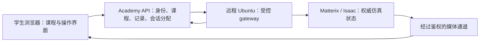

# Flex 新手学习体验与远程 Ubuntu 设计

日期：2026-09-30。状态：目标设计；首课教学版本已实现，远程 Ubuntu 仍待联调。适用对象：有手动移液和基础实验经验、没有使用过 Opentrons 的学生。

本轮实现：五阶段英文首课、设备导览、固定 D3 废弃槽、准备清单、预测检查、100/50 µL 单步练习、解释与尝试记录；原有稀释练习保留。中心视图是明确标注的教学示意图，不是真实 3D。远程客户端和只读连接检查已加入，gateway 服务、会话排队、原生观测及鉴权媒体尚未实现或验收。下文的基线盘点记录的是开发前状态，后续目标不能视为当前能力。

## 产品目标与部署决定

学生完成课程后，能够解释 Flex 上的设备和耗材，正确准备一项受支持的实验，独立编排和运行仿真，并利用观察结果定位常见错误。完成仿真课程不等于获得实体机器操作资格。

本阶段以**连接一台已有的远程 Ubuntu GPU 服务器**为设计前提。Matterix/Isaac 在 Ubuntu 上运行；Academy 提供课程、学生操作入口和记录。网站可在本地开发，未来部署 AWS。当前不以创建 AWS GPU 实例作为前置条件。

学生通过浏览器使用平台，不领取 Ubuntu 账户、不使用 SSH、不操作通用 Ubuntu 桌面或 Isaac 编辑器。服务器安装、网络与驱动由管理员维护。

## 已完成的基础与实际缺口

核对基线：`dce025cda99c75a0294a44b551ba4bea01e1565b`。2026-09-30 重新查询该版本的 GitHub Actions，状态为 success；下列测试数量来自 2026-09-28 的验证记录，本次设计未重跑测试。

| 领域 | 当前已有 | 尚缺 |
| --- | --- | --- |
| 进入平台 | 本地访客、姓名和经验登记、三步介绍；Cognito 集成代码 | 真正的设备入门教学、按技能恢复学习进度；云端登录验收 |
| 课程 | 一个连续稀释练习 | 设备认识、首次转移、准备检查、混匀、故障练习、独立任务 |
| 实验台 | 四种对象的二维台面示意、选择/拖动/交换位置 | 真实 3D、机身/运动/孔位细节、对象识别、符合 Flex 的摆放约束 |
| 编排与运行 | 编辑四种动作及体积/顺序，保存、运行、暂停、单步、重置 | 科学任务到动作的解释、真实远程执行、运行前检查、原生执行回执 |
| 反馈 | 简化体积/浓度记录、部分错误提示、达标判断、尝试历史 | 同步场景解释、预测与观察比较、错误归因、技能评估 |
| 仿真 | 独立的 synthetic 教学模型，理想混合、液量守恒、课程吸头规则 | Ubuntu gateway、Isaac 画面、原生动作/对象状态、碰撞和混匀能力验证 |
| 云端准备 | Terraform、部署工作流、存储和鉴权代码 | AWS 实际部署、身份/权限验收；与现有 Ubuntu 的网络连通 |

已有验证：81 个后端测试、5 个 Chromium 旅程，构建、格式、Lambda 打包和 Terraform validate。详见 [VALIDATION.md](VALIDATION.md)。这些不是 Ubuntu、GPU 或课堂并发的验证。

### 在学生试用前必须修正的教学准确性问题

1. `models.py` 默认把 waste chute 放在 A3，前端允许像普通耗材一样交换其位置。Flex waste chute 实际只安装在 D3；trash bin 是另一种 fixture，不应混为一谈。[设备说明](https://docs.opentrons.com/flex/system-description/robot/)
2. 台面位置目前不影响动作结果。后续每个动作须绑定 labware ID、well ID 和当前场景位置，由 Matterix 验证可执行性；不能只把图片摆放当作完成布台。
3. 现在的 300 µL 移液器上限与 1,500 µL 容器容量是教学模型常量，不是整个 Flex 产品线的规格。课程所选真实型号、吸头和 labware definition 必须明确，范围从版本化设备清单读取。
4. 当前只有 `pickup/aspirate/dispense/drop` 四种动作，默认瞬时混匀。稀释课必须明确混匀步骤及其假设；没有经验证的混匀能力时，不把“浓度达标”解释成实际物理混匀成功。
5. 课程的“每次转移换新吸头”是本课策略，不能作为全部 Opentrons 实验的通用换头规则。
6. “台面 A1 槽位”和“孔板 A1 孔”属于不同层级。所有初学者界面写成“D2 槽位 → 孔板 → A1 孔”，避免只显示 A1。

## 学生先要学什么

学生界面统一使用英文，包括解释、设备术语、提示、评估与连接状态。先使用标准化教学液体和受支持的耗材，避免把复杂样品性质与机器人入门同时引入。

| 学生已经熟悉的手动操作 | 需要补上的自动化概念 | 平台中的小练习 |
| --- | --- | --- |
| 选择合适量程的移液枪和吸头 | 安装的移液器型号、通道数、兼容吸头与工作体积 | 为 100 µL 转移选择已支持的组合，并解释原因 |
| 用眼睛找到试剂管和目标孔 | 台面槽位、耗材定义、方向、孔位地址 | 找出 D2 槽位上孔板的 A1 孔，并检查方向 |
| 根据液面调整吸液位置 | 初始液量、可用余量、吸液高度和液体性质 | 预测液量不足时会发生什么；未建模的因素标明教学说明 |
| 手动吸液、排液、换吸头和混匀 | 显式有序动作、前置条件与耗材状态 | 将一段手写 SOP 拆成操作序列 |
| 实验前检查台面 | 仪器、fixture、耗材、液体与位置检查 | 找出一处刻意设置的布台错误 |
| 看到异常后停下来判断 | 暂停/停止的区别、执行确认、恢复与重置 | 在异常后先确认执行状态，再决定修复方法 |

位置检查教学应让学生理解 Labware Position Check 的目的和流程；虚拟检查不能生成或证明实体机器的校准/offset。[官方运行准备](https://docs.opentrons.com/flex/touchscreen/protocol-setup/)

## 学习路径

采用“示范 → 带提示练习 → 减少提示 → 独立完成”的过程。每课保存完成证据、使用过的提示和重试记录；看完页面或点击下一步不算掌握。自由探索可以随时进入，基础未完成时保留针对性提示，不把探索隐藏在冗长考试之后。

| 阶段 | 学生要回答的问题 | 具体操作 | 完成证据 |
| --- | --- | --- | --- |
| 1. 从手动实验到自动化 | 机器需要我明确告诉它什么？ | 把一次手动移液拆解为耗材、液体、位置与动作 | 能指出 SOP 中遗漏的初始条件 |
| 2. 认识 Flex | 哪个部件做什么？ | 点击机身、移液器、吸头架、孔板、废弃槽；相机聚焦并展示用途 | 能找到源容器、目标孔和吸头位置 |
| 3. 准备实验台 | 放对位置就够了吗？ | 按清单选择型号、方向、槽位，填写液体与初始体积 | 型号、方向、位置和液体检查全部通过 |
| 4. 第一次转移 | 100 µL 是怎样从源头到目标的？ | 先观看一次示范；预测变化；单步执行取头、吸液、排液、弃头 | 能解释源/吸头/目标三处体积变化 |
| 5. 连续稀释 | 每一步如何影响最终结果？ | 配置稀释液，加入明确混匀步骤，重复转移；对比目标与结果 | 解释浓度、体积及吸头策略；区分模型推算和原生观测 |
| 6. 犯错与恢复 | 为什么失败，该从哪里修正？ | 练习无吸头、源液不足、错误孔位、遗漏混匀等已支持场景 | 找到原因，修正计划，并在确认的初始状态重试 |
| 7. 自由实验 | 我能把自己的 SOP 变成流程吗？ | 自选受支持耗材、体积、孔位和序列；改变一个条件比较结果 | 保存可解释的两次尝试及差异 |
| 8. 独立挑战 | 离开逐步提示还能完成吗？ | 给定目标而不提供完整脚本；准备、预测、运行、诊断和复盘 | 可复现的完成记录，以及仍需学习的技能 |

首个端到端验收课选择**一次 100 µL 转移**。连续稀释是下一课，不能让新手第一次进入就面对完整稀释流程。

## 第一课的完整教学脚本

教学任务：将 100 µL 教学液体从源容器转移到空目标孔。实际移液器和耗材型号以 Ubuntu 场景清单为准，不预先声称任何型号已接入。

1. 呈现实验目的和目标孔，先展示熟悉的手动 SOP：取新吸头、从源液吸取 100 µL、转移到指定孔、弃头。
2. 在设备导览中点击对应部件。每次只突出一个部件，说明“它是什么”“在本实验中做什么”“最容易混淆什么”。
3. 放置支持的耗材并核对方向。位置名称始终包含槽位、耗材和孔位。废弃槽固定到 D3。
4. 确认初始量：源容器 1,000 µL、目标孔 0 µL、吸头内 0 µL。学生预测吸液后和排液后的三个量。
5. 运行准备页依次核对设备、耗材、液体、路径/动作支持和远程会话状态。显示具体不通过项和返回修改的位置。
6. 单步取头。实时画面与状态都确认完成后，强调吸头状态改变；让学生指出为什么要先取头。
7. 单步吸液。期望账本：源 900 µL、吸头 100 µL、目标 0 µL；界面说明这些量的来源。没有原生液量观测时，不把课程账本写成测量值。
8. 单步排液。期望账本：源 900 µL、吸头 0 µL、目标 100 µL。展示动作、对象和变化之间的对应关系。
9. 弃头并复盘。对比学生预测、动作回执和可用观测；指出未验证的液体物理因素。
10. 学生将体积改为 50 µL，从已确认的重置状态再次执行，并在运行前填写新的预测。该迁移任务用于判断是否理解，而非只会照做。

## 学习工作台的信息结构

视觉方向：延续暖纸色、深绿和实验记录本风格，将信息组织成稳定的学习工作台。React + TypeScript、CSS Modules 保持不变；不为远程串流单独增加 Three.js。桌面优先；窄屏提供分区切换，避免压缩后的 3D 视口无法操作。所有对象选择都有可键盘使用的列表入口，状态不能只靠颜色表达。

```text
┌──────────────────────────────────────────────────────────────────────┐
│ 第一课：转移 100 µL      学习目标      远程仿真状态 · 观测更新时间    │
├──────────────┬──────────────────────────────────┬────────────────────┤
│ 学习步骤     │ 真实 Matterix 3D 画面            │ 当前操作解释       │
│ 1 认识设备 ✓ │                                  │ 吸取 100 µL        │
│ 2 准备台面 ✓ │ 对象标注 / 选择 / 聚焦           │ 为什么这么做       │
│ 3 预测变化 ✓ │ 俯视 / 整机 / 移液器近景         │ 操作前需要什么     │
│ 4 单步吸液   │                                  │ 预计发生什么       │
│ 5 单步排液   │ 选中：D2 槽位 → 孔板 → A1 孔    │ 观察结果 / 提示    │
├──────────────┴──────────────────────────────────┴────────────────────┤
│ 操作序列：取头 ✓ → 吸液（进行中） → 排液 → 弃头                      │
│ 源液量 | 吸头状态/液量 | 目标孔液量 | 证据来源 | 待确认操作           │
│ 单步执行 / 连续运行 / 请求暂停 / 停止并结束 / 从初始状态重新开始      │
└──────────────────────────────────────────────────────────────────────┘
```

常驻内容只回答四个问题：现在做什么、为什么、发生了什么、下一步做什么。课程解释默认简短；参数细节、术语和完整日志按需展开。学生不用读日志才能知道错误。

### 3D 需要承担的教学功能

- 整机定位：看到真实机身与运动机构、耗材形状和安装关系；在俯视图定位后可回到整机视角。
- 对象导览：点击对象得到名称、用途、当前状态和相关概念；选中源/目标时同时高亮动作卡。
- 操作追踪：选择当前步骤时聚焦相应位置，允许关闭自动跟随；显示已完成、执行中与计划中三种状态。
- 局部观察：预设吸头/孔位近景用于理解动作。截面、透明化、液面等视图仅在对应能力经过验证后启用。
- 错误解释：高亮出错的对象，结合条件说明原因；提供“返回修改”“查看这一概念”“重置再试”等具体路径。
- 复盘：从操作记录查看当时的状态。录像回放、事件回放和重新仿真分别标识；当前系统没有这些完整回放能力。

视频本身没有对象语义。对象选择/高亮/相机聚焦需要 gateway 提供 stable object ID、受限相机控制及选择结果；不能靠在视频上放静态标签假装精确对应。若 Ubuntu 暂无这些能力，先提供固定相机与同步对象列表，并把限制标明。

## 远程连接与运行行为



控制与状态经 Academy API 和 gateway；媒体走单独受控通道。AWS API Gateway/CloudFront 不能被当作任意 WebRTC UDP 代理。网络采用管理员配置的私网路径或受鉴权加密的入口；部署时验证实际网络和安装版本，学生不填写主机地址或凭据。

第一阶段仅支持**一个活动学生会话，其他学生排队**。每次交接执行完整重置并核对场景和所属学生。共享的是经确认的初始模板，不共享学生可变的实验状态。并发会话在 GPU 资源、实例隔离和串流经过测试后增加。

| 情况 | 学生看到的反馈 | 平台行为 |
| --- | --- | --- |
| 等待资源 | 排队中，可继续阅读课程或编辑草稿 | 不显示未经测量的精确倒计时 |
| 启动/加载 | 连接中、加载场景、恢复状态的分步状态 | 场景与媒体准备好后才启用执行 |
| 执行动作 | 已提交 → 执行中 → 已完成/失败 | 命令唯一 ID、期望版本和远程回执；不凭动画结束判断成功 |
| 暂停 | 已请求暂停 / 已确认暂停 | 是否可在动作中暂停由原生能力决定；必要时在动作边界暂停 |
| 画面卡顿 | 画面延迟，最近观测时间 | 画面状态和执行状态分别显示，不推断机器人停止 |
| 连接中断 | 连接中断，正在确认上一操作 | 禁止新的学生指令；gateway 到操作边界执行已约定的暂停策略，重连核对操作结果，不能自动重发转移 |
| 超时/未知结果 | 上一步结果待确认 | 根据 operation ID 查询，恢复权威状态后才允许继续 |
| 结束/租约到期 | 本次记录已保存，练习已结束 | 结束会话并清理资源；在清理确认前不交给下一名学生 |
| 重置 | 正在恢复初始场景 | 同时恢复对象位置、附件/吸头、液体和控制器；失败时隔离该会话 |

详细命令边界仍由 [MATTERIX-CONTRACT.md](MATTERIX-CONTRACT.md) 定义；本设计没有把其中尚不存在的 endpoints 变成已实现能力。流媒体接入、对象选择、camera focus 和课程观测需要新增并独立验证。

## 状态来源与学习评估

Academy 管课程、计划、预测、提示与尝试记录；Matterix 管场景、执行结果和原生观测。adapter 只映射，不创建第二份权威物理状态。

每个数值带来源：学生设置 / 课程模型推算 / Matterix 原生观测 / 未提供。可附观测时间、单位、对象 ID 和版本。渲染画面不能证明液体体积或化学效果；碰撞、污染、混匀和液面必须分别列明已建模、规则提示或尚未支持。

新增记录至少包括 lesson ID/version、learner ID、任务版本、场景/设备/耗材版本、计划、预测、操作 ID 与结果、前后观测、提示使用、错误、重试与评价。保留失败尝试，不用一次成功覆盖之前的错误。

评估分三类：理解概念、准备与执行、诊断与迁移。一次“流程结束”不代表完成学习；独立挑战要检查布台、预测、操作结果、错误解释与修改后的再次执行。

## 实施顺序与验收

| 顺序 | 可交付成果 | 可检查的完成条件 |
| --- | --- | --- |
| P0 教学准确性 | 修正 fixture、对象地址、型号/容量标识、混匀与吸头策略说明 | 学生不会从界面学到错误槽位或把理想模型当物理事实 |
| P1 新手路径 | 设备导览、手动到自动化映射、100 µL 第一课、准备清单、步骤解释 | 一位未用过 Flex 的学生能在提示下完成并解释一次转移；服务器未连接时明确不可执行 |
| P2 远程闭环 | 单学生租约、原生状态/动作、鉴权视频、暂停/重连/完整重置 | 第一课在 Ubuntu 真正执行；断线不重复吸排液；下一位学生看到干净初始状态 |
| P3 试错与迁移 | 连续稀释、支持的故障练习、自由编排、复盘与独立挑战 | 学生能诊断至少两类错误，并独立完成改变体积/目标的任务 |
| P4 课堂使用 | 教师查看进度、队列、资源配额、经测量的并发方案 | 两名学生不能访问彼此场景，教师能定位常见学习障碍 |

产品验收以真实新手试用为准：能否正确找到设备/孔位、说出动作前置条件、解释体积变化、理解提示并修正流程。记录卡住的位置与求助次数，不把页面停留时间当作学习成效。

首课教学版本已经修改应用功能；尚未连接 Ubuntu 或创建云资源。P0/P1 的课程基础已落地，P2 目前提供契约客户端；真实转移闭环仍需服务器侧实现与联调。复杂 3D 操作和更多课程按能力逐步展开。

## 参考依据

- [Opentrons Flex：Robot Components](https://docs.opentrons.com/flex/system-description/robot/)：台面/fixture 与操作空间。
- [Opentrons Flex：Labware Concepts](https://docs.opentrons.com/flex/labware/concepts/)：耗材与定义。
- [Opentrons Flex：Protocol Setup](https://docs.opentrons.com/flex/touchscreen/protocol-setup/)：运行前准备类别。
- [Opentrons Flex：Protocol Designer](https://docs.opentrons.com/flex/protocols/designer/)：配置设备、定义耗材/液体、编排操作的概念顺序。
- [NVIDIA：Livestream Clients](https://docs.isaacsim.omniverse.nvidia.com/latest/installation/manual_livestream_clients.html)：串流与会话限制。实际集成需再次对照服务器安装版本。

上述资料用于核实产品事实；课程顺序、界面布局、检查点和评估方案是本设计的教学选择。
